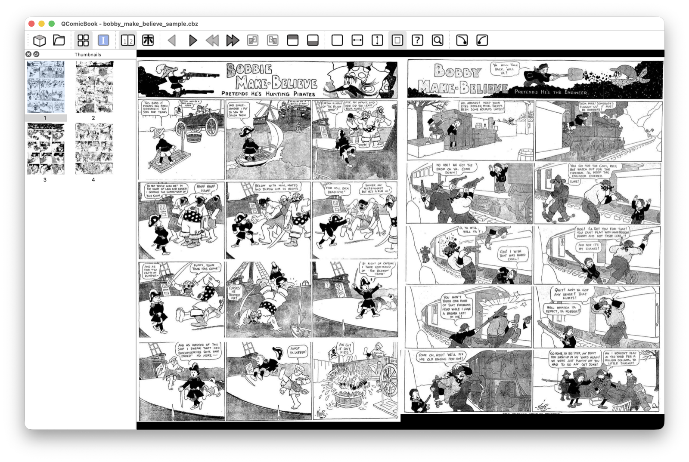
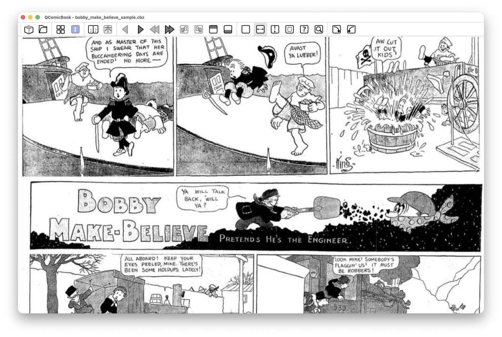
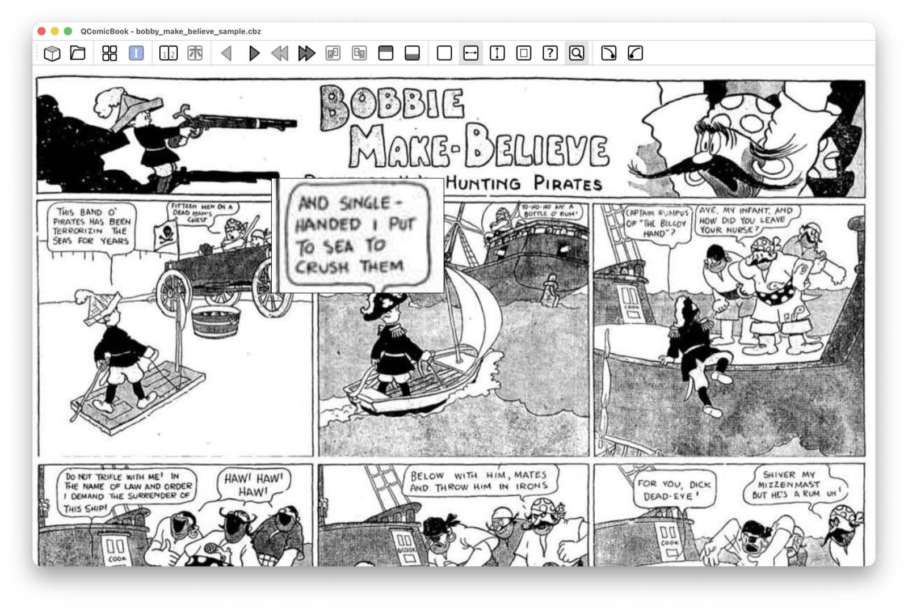

QComicBook
==========
Copyright (C) 2005-2016 Pawel Stolowski, 2026 Valerio Perticone  
Released under the GNU General Public License version 2

1. Introduction
---------------
QComicBook is a viewer for PDF files and comic book archives containing
jpeg/png/xpm/gif/bmp images, which aims at convenience and simplicity.
Features include: automatic unpacking of archive files, full-screen mode, continuous
scrolling mode, double-pages viewing, manga mode, thumbnails view, page scaling,
mouse or keyboard navigation etc. QComicBook runs on Linux and macOS.

  
  
  

2. Requirements
---------------
QComicBook requires Qt libraries version >=6.4 (qtcore, qtwidgets, qtprintsupport,
and qttools for the translations), poppler-qt6 library, pkg-config and cmake (>=3.16).

You will also need unzip, rar (or unrar, or 7zz from 7-Zip), unace, 7z (or 7zz)
and tar (with gzip and bzip2 support compiled in) somewhere in your PATH to
handle archives. On macOS unzip and tar come with the system, and 7zz is
installed by `brew install sevenzip`. If one of
these tools is missing you can still use QComicBook, but you won't be able to
open some archives. You may check status of supported archives via Help > System information
menu option of QComicBook.

3. Installation
---------------
To compile QComicBook, you will need Qt6 developement packages (usually named
-dev- or -devel- in many distros) and libpoppler-qt6 devel package. On Debian and
Ubuntu (24.04 or later):

    $ sudo apt install build-essential cmake pkg-config qt6-base-dev qt6-tools-dev \
        qt6-tools-dev-tools qt6-l10n-tools libpoppler-qt6-dev

Compilation includes three steps:

    $ cmake . -DCMAKE_INSTALL_PREFIX=/usr -DCMAKE_BUILD_TYPE=Release
    $ make
    $ make install

(the -D... argument is optional; if not specified, qcomicbook will be installed in
/usr/local directory).

If you want to compile qcomicbook with e.g. /usr prefix, but install it to a temporary
location for packaging, then pass DESTDIR variable to 'make install', e.g.

    $ make install DESTDIR=/tmp/package_root

On macOS, install the dependencies with Homebrew, and tell pkg-config where
poppler-qt6 is:

    $ brew install pkgconf qtbase qttools qttranslations poppler-qt6
    $ export PKG_CONFIG_PATH="$(brew --prefix poppler-qt6)/lib/pkgconfig"

then run cmake and make as above (without 'make install'): they build
src/QComicBook.app. To make the app self-contained and pack it into a .dmg disk image:

    $ sh data/macos/make-dmg.sh .

Ready-made .dmg images for Apple silicon (macOS 15 or later) are attached to the
GitHub releases. The app isn't notarized by Apple: the first time you open it,
macOS refuses it; open System Settings > Privacy & Security and click "Open Anyway".

4. Known issues
---------------
* rar/unrar (and unzip/unace probably too) may have problems with files/dirs in the
archive, which names contain non-ascii characters (like special characters for you
language). As a result they won't be decompressed and qcomicbook may show
"No images found" error box.
* the free (opensource) unrar doesn't currently support 3.0 rar archives. Such archives are reported
as empty by QComicBook. It is *recommended* to use non-free rar/unrar, or 7zz.

5. Bugs
-------
Ideally, your bug report should include:
- description of problem.
- list of steps that reproduce the problem (if it's reproducible).
- console output from QComicBook (recompile QComicBook with -DCMAKE_BUILD_TYPE=Debug flag to enable debug
  messages).
- sample comic book archive that causes problems if problem is only reproducible with particular archive.
  Please reduce the number of images in the archive to the minimum needed for reproducing bug.

Please report bugs on the GitHub issue tracker: https://github.com/valepert/QComicBook/issues

6. Translations
---------------
If you want to translate QComicBook to a language of your choice, please read on.

First off, check the open issues and pull requests to ensure no one else is
working on same translation.
Then retrieve the latest QComicBook sources using git client, or via web
interface (download a snapshot tarball) - go to 
https://github.com/valepert/QComicBook

Once you have the snapshot of QComicBook compiled, do the following:

1. Change directory to i18n and execute "update_ts.sh qcomicbook_xx_XX.ts"
(replace xx_XX with yours country code; Qt 6 lupdate must be in your PATH).
This will create a skeleton file for your translation.
2. Run Qt Linguist, open the generated .ts file and translate it.
3. In Qt Linguist, click "Release As.." and save the resulting .qm file
to /usr/share/qcomicbook/i18n/ directory (or wherever you installed
qcomicbook).
4. Run QComicBook; you should now see your translated messages.
5. Once you are happy with your translation, send the .ts file as a pull request
on GitHub.
